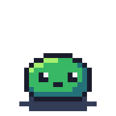

# anima-o

Engine de animação **pixel art controlada por IA**. Você descreve o que quer ("um slime verde pulando em loop", "deixa o chapéu vermelho", "mais rápido") e o Claude desenha, anima e ajusta os sprites pixel por pixel. O canvas atualiza ao vivo a cada passo.



## Como rodar

Requer Node 21.7 ou mais novo.

```bash
npm install
```

```bash
cp .env.example .env   # e preencha ANTHROPIC_API_KEY
```

```bash
npm run dev
```

Abra http://localhost:5173. Sem chave de API dá para usar o editor manual e o botão **Demo**.

| Comando | O que faz |
|---|---|
| `npm run dev` | servidor + interface com hot reload |
| `npm test` | testes da engine e do loop do agente |
| `npm run build` e `npm start` | build de produção |

## Como funciona

```
 navegador (web/)                   servidor (server/)                Claude
┌──────────────────┐  POST /api/chat ┌───────────────────┐  tools   ┌─────────┐
│ canvas, timeline │ ──────────────▶ │ loop do agente    │ ───────▶ │         │
│ editor manual    │ ◀── SSE ─────── │ executa comandos  │ ◀─────── │         │
│ exporta GIF/PNG  │  texto, tool,   │ da engine, manda  │ tool_use │         │
└──────────────────┘  projeto        │ imagem p/ a IA ver│          └─────────┘
         │                           └───────────────────┘
         └──────── os dois usam a mesma engine (src/engine/) ────────┘
```

**A engine (`src/engine/`)** é TypeScript puro, sem DOM, e roda igual no navegador e no Node:

- `project.ts`: o modelo. Um projeto é uma grade de frames × camadas, e cada célula guarda índices de paleta (0 = transparente), como num GIF.
- `draw.ts`: primitivas de pixel art (linha de Bresenham, retângulo, elipse, balde, deslocamento, espelho, contorno automático).
- `commands.ts`: **a API que a IA controla.** Cada comando tem um schema Zod, que vira a definição de *tool* do Claude, e uma função que aplica o comando. Os comandos são atômicos: se falham, o projeto não muda.
- `ascii.ts`: a arte como texto, um caractere por pixel. É assim que a IA escreve sprites com precisão (`draw_rows`) e lê o que já existe (`view`).
- `render.ts`, `gif.ts`, `serialize.ts`: renderização RGBA, spritesheet, GIF animado e o formato `.anima.json`.

**O agente (`server/agent.ts`)** roda o loop de *tool use* com o Claude (`claude-opus-5-5`, pensamento adaptativo, streaming). Depois de desenhar, a IA chama `view` e recebe a grade de texto **e uma imagem PNG** do frame, então consegue ver e corrigir o próprio trabalho.

### Comandos disponíveis para a IA

| Comando | Para quê |
|---|---|
| `set_canvas` | nome, tamanho, fps |
| `set_palette`, `remove_colors` | cores. Mudar o hex de uma chave recolore toda a animação |
| `add_layer`, `update_layer` | camadas: criar, renomear, esconder, reordenar, apagar |
| `add_frames`, `delete_frames`, `move_frame`, `set_frame_timing` | timeline e tempo de cada frame |
| `draw_rows` | desenho pixel a pixel por texto |
| `draw_shapes` | pixels, linhas, retângulos, elipses, balde |
| `transform` | deslocar (com wrap), espelhar, trocar cor, contornar, limpar |
| `copy_layer_content` | copiar conteúdo entre frames/camadas com deslocamento |
| `view`, `get_project_info` | ver o estado (texto + imagem) |
| `export` | baixar GIF, spritesheet PNG ou JSON no navegador |

Exemplo de `draw_rows` (um coração 7×6):

```json
{ "rows": [".00.00.", "0rr0rr0", "0rrrrr0", ".0rrr0.", "..0r0..", "...0..."] }
```

`examples/slime.ts` mostra uma animação completa feita só com esses comandos.

### Conversa e edição

- A conversa fica no servidor (em memória), então a IA lembra do que fez. **Nova conversa** limpa esse histórico.
- O navegador é a fonte da verdade do projeto. Você pode editar à mão entre mensagens, e a IA recebe o estado atualizado a cada pedido.
- Cada rodada da IA pode ser desfeita com um único **Ctrl+Z**.

### Atalhos

`B` lápis · `E` borracha · `G` balde · `I` conta-gotas · `Espaço` play/pause · `←/→` frames · `Ctrl+Z` / `Ctrl+Shift+Z`

## Configuração (`.env`)

| Variável | Padrão | |
|---|---|---|
| `ANTHROPIC_API_KEY` | (nenhum) | obrigatória para a IA |
| `ANIMA_MODEL` | `claude-opus-5-5` | modelo usado |
| `ANIMA_EFFORT` | `high` | `low`, `medium`, `high`, `xhigh` ou `max`. Mais alto = arte mais cuidadosa, porém mais lento e mais caro |
| `PORT` | `5173` | porta do servidor |

O loop usa o fallback automático do servidor (`fallbacks: "default"`): se o modelo principal recusar um pedido, outro modelo continua a resposta na mesma chamada.
